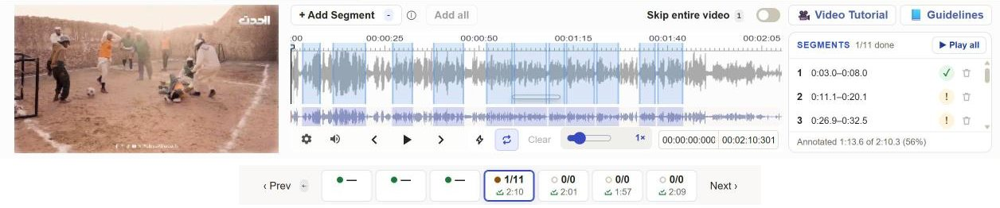
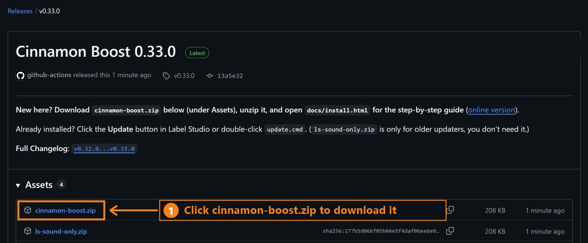

# Cinnamon Boost

A Chrome extension that makes [Label Studio](https://labelstud.io/) faster and easier for **audio and video transcription**. It puts the video, the waveform and a segment list in one window, keeps files on your computer so tasks open instantly, and adds keyboard shortcuts for the whole workflow.

**New here? Go to [Install](#install-once-about-2-minutes).**



> Built for the team's Label Studio server (`annotation.dlnlp.ai`, Label Studio 1.23). See [Using it on another server](#using-it-on-another-server).

---

## For annotators

### Install (once, about 2 minutes)

1. Open the [latest release](https://github.com/NourZohdy/cinnamon-boost/releases/latest) and click **`cinnamon-boost.zip`** under *Assets* to download it.

   

2. Follow the **illustrated install guide** (English / العربية). It takes you from unzipping to the finished setup. Open it either way:
   - **Online:** [nourzohdy.github.io/cinnamon-boost/docs/install.html](https://nourzohdy.github.io/cinnamon-boost/docs/install.html)
   - **Offline:** unzip the file, then open **`docs/install.html`** inside the folder.

Already know Chrome extensions? Unzip into a folder you will keep, then `chrome://extensions` → turn on **Developer mode** → **Load unpacked** → choose the folder.

### Update to a new version

When a new version is out, an **Update** button appears in the extension's bar in Label Studio, and the extension icon shows **NEW**.

1. Double-click **`update.cmd`** in your Cinnamon Boost folder (the same folder you originally loaded in Chrome). It downloads the new version into that folder.
2. Click the extension icon, then **Reload extension**.
3. Refresh the Label Studio tab.

Your settings are kept. If Windows shows "Windows protected your PC", click **More info → Run anyway** (the script only downloads the latest release from this page).

You can also update by hand: download the zip again and unzip it over the same folder, then click the reload arrow on the extension in `chrome://extensions`.

### What it does

- **Compact layout**: video, waveform and questions in one window, with a segment list (play, jump, delete, *Play all*).
- **Task tiles** at the bottom: status, segments done, length and download state of the tasks around you; *Prev / Next*.
- **Instant tasks**: opened videos are kept on your computer (up to 6), and the next tasks download in the background.
- **Sound tools**: smooth playback, *Speed mode* (wave plays without waiting for the picture), speed slider, loop.
- **Waveform**: overview strip, gentle Ctrl + wheel zoom, drag the ruler to scrub, click a segment to replay it, segment length while dragging, *Add all* highlights as segments.
- **Safer submit**: a second Submit on the same task updates your annotation instead of creating a duplicate.
- **Settings popup**: choose *Full* (recommended), *Loading fix only* (faster loading and smoother playback with the standard layout), or *Off*. You can also toggle features individually and rebind shortcuts.

### Keyboard shortcuts (default)

| Key | Action |
|---|---|
| `Space` | Play / pause |
| `9` / `0` | Jump back / forward 1 second (`Alt+9` / `Alt+0` while typing) |
| `Tab` / `Shift+Tab` | Next / previous segment |
| `Y` / `N` | Code-switching: Yes / No (selected segment) |
| `Ctrl` (alone) | Go to the transcription box |
| `Enter` | Save the transcription text |
| `→` | Submit / Update, or go to the next task |
| `←` | Previous task |
| `Ctrl` + mouse wheel | Zoom the wave |
| `Alt+L` | Show / hide the task list |

### Something wrong?

Open the extension's settings (cinnamon roll icon) and choose **Off**, then reload the Label Studio tab. Please [open an issue](https://github.com/NourZohdy/cinnamon-boost/issues) or tell the maintainer what happened.

### Privacy

Everything stays in your browser. The extension talks only to your Label Studio server, and once in a while to the GitHub API to check for a new release. Cached videos are stored in the browser's storage for the Label Studio site.

---

## For developers

Requirements: Chrome or Edge, Node.js 22.13 or newer.

```sh
npm ci            # ESLint and jsdom for the tests
npm test          # syntax checks, ESLint and every test_*.mjs suite
npm run package   # builds dist/cinnamon-boost.zip (runtime files only)
```

For development, load the repository folder itself with **Load unpacked**. In a Label Studio tab, `window.postMessage('so-dev-reload', '*')` reloads the extension (this hook is switched off in the packaged build).

### Layout

| Path | What it is |
|---|---|
| `manifest.json` | Extension manifest; its `version` is the release version |
| `src/background.js` | Service worker for update checks and isolated-world bridge that mirrors settings into the page |
| `src/shared/settings.js`, `src/shared/update.js` | Settings model and shared update logic |
| `src/page/content.js`, `src/page/content.css`, `src/page/helpers.js`, `src/page/runtime.js` | Main-world entry point, styles, helpers and runtime |
| `src/page/features/*.js` | Cache, preload, toolbar, sound, layout, segments, pager, gestures, overview and keyboard |
| `src/popup/` | Settings popup HTML, JavaScript and CSS |
| `docs/install.html`, `docs/images/screenshot.jpg` | Illustrated install guide and screenshot |
| `icons/` | Extension and guide icons |
| `update.cmd` | One-click updater included in the zip |
| `scripts/` | Test runner, packager, icon generator |
| `tests/` | Tests (plain Node + jsdom, with a fake Label Studio in `tests/test-support/`) |
| `.github/workflows/` | CI and release workflows |
| `package.json`, `package-lock.json`, `eslint.config.mjs` | npm commands, dependency lockfile and lint settings |
| `.gitignore`, `.gitattributes` | Git ignore rules and file attributes |

### Releasing a new version

1. Bump `version` in `manifest.json` and commit to `main`.
2. Tag and push: `git tag v0.33.0 && git push origin main v0.33.0`.
3. The *Release* workflow checks that the tag matches the manifest, runs the tests, builds `cinnamon-boost.zip` and publishes the GitHub release. Teammates see the Update button within a few hours.

### Using it on another server

The content scripts only run on `https://annotation.dlnlp.ai/*` (see `matches` in `manifest.json`). To use another Label Studio server, change both `matches` entries. The compact layout is tuned to this project's form (a video, an audio wave and its question headings); on other forms turn *Compact workspace* off in the settings. The sound, cache and keyboard features do not depend on the form.
